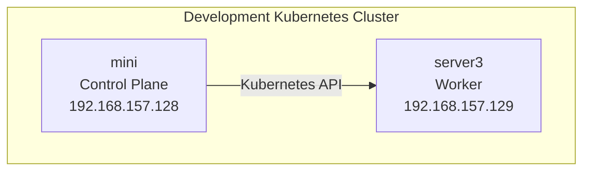

# 🏗️ Development Kubernetes Cluster

A hands-on Kubernetes project focused on building and managing a small development environment using **kubeadm**, **containerd**, and **Flannel**.

The goal is to build a multi-node Kubernetes cluster and use it to deploy and manage a web application, while exploring core DevOps and Kubernetes concepts.

## 🖥️ 1. Architecture

The planned cluster consists of one Control Plane node and one Worker node.

## 🖧 2. Infrastructure

| Node | Role | IP Address | Operating System |
| :--- | :--- | :--- | :--- |
| `mini` | Control Plane | `192.168.157.128` | Ubuntu 22.04 |
| `server3` | Worker (planned) | `192.168.157.129` | Ubuntu 22.04 |

## ⚙️ 3. Technology Stack

| Technology | Purpose |
| :--- | :--- |
| Kubernetes | Container orchestration |
| kubeadm | Cluster initialization and node management |
| kubelet | Node agent |
| kubectl | Kubernetes command-line interface |
| containerd | Container runtime |
| Flannel | Container Network Interface (CNI) |

## 📦 4. Application Workloads

The planned application deployment is based on VProfile.

The application consists of three main components:

- **vproweb** – Web component
- **vproapp** – Application component
- **vprodb** – Database component

These components will be deployed as Kubernetes workloads using container images.

Persistent storage and application configuration will be addressed during the deployment phase.

## 📋 5. Current Status

- [x] Kubernetes Control Plane initialized on `mini`
- [x] Containerd configured as the container runtime
- [x] Flannel CNI installed
- [x] Control Plane node in Ready state
- [x] Kubernetes 1.37.2 tools installed on `server3`
- [x] Containerd CRI plugin enabled on `server3`
- [ ] Complete Worker node configuration
- [ ] Join `server3` to the cluster
- [ ] Deploy VProfile workloads
- [ ] Configure persistent storage
- [ ] Test application connectivity

## 🎯 6. Project Goals

- Understand Kubernetes cluster architecture and node communication.
- Practice container orchestration with kubeadm.
- Deploy and manage a multi-component application.
- Work with Kubernetes networking and persistent storage.
- Explore practical DevOps workflows in a development environment.

---

**Project Status:** In Progress
