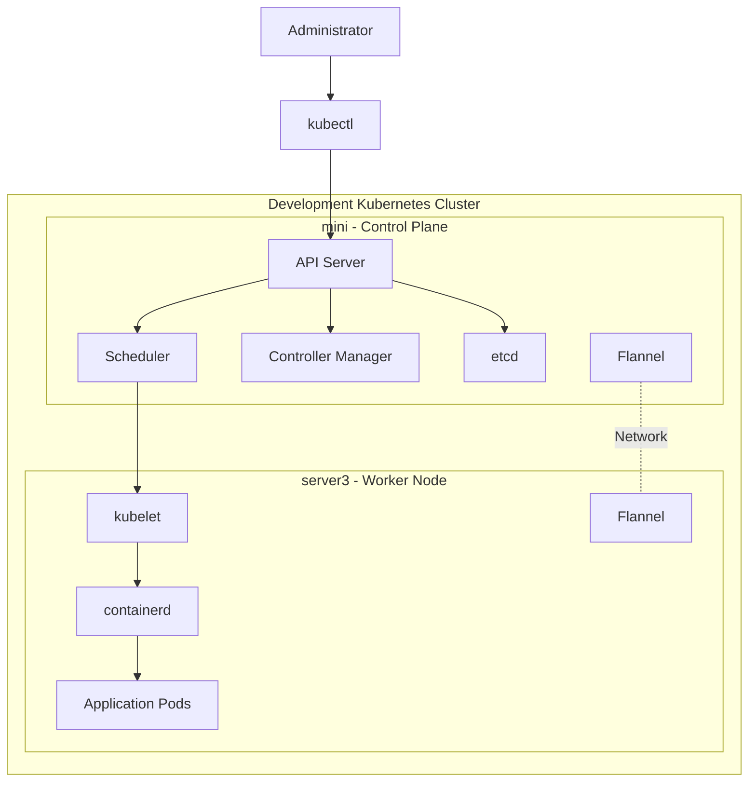
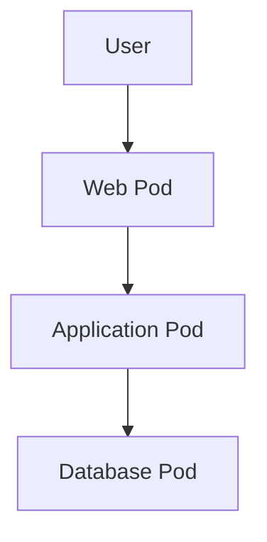

# 🏗️ Kubernetes Cluster Architecture

## 1. Project Overview

This document describes the architecture of the Development Kubernetes Cluster built as part of a personal DevOps Home Lab.

The goal is to simulate a small company's infrastructure using virtual machines, Kubernetes, containerized applications, and DevOps tools.

The architecture will evolve as new components and services are introduced.

---

## 2. Infrastructure Overview

The Kubernetes cluster currently consists of two Ubuntu Server virtual machines.

| Node | Role | IP Address | Operating System |
| :--- | :--- | :--- | :--- |
| `mini` | Control Plane | `192.168.157.128` | Ubuntu 22.04 |
| `server3` | Worker Node | `192.168.157.129` | Ubuntu 22.04 |

### Node Responsibilities

**mini – Control Plane**

- Manages the Kubernetes cluster.
- Runs the Kubernetes control plane components.
- Schedules workloads across available nodes.
- Provides cluster administration through `kubectl`.

**server3 – Worker Node**

- Runs application workloads scheduled by Kubernetes.
- Hosts application Pods.
- Uses containerd as its container runtime.

---

## 3. Cluster Architecture

---

## 4. Technology Stack

| Component | Technology | Purpose |
| :--- | :--- | :--- |
| Virtualization | VMware Workstation | Virtual machine management |
| Operating System | Ubuntu Server 22.04 | Host operating system |
| Container Runtime | containerd | Running containers |
| Container Orchestration | Kubernetes | Managing workloads |
| Cluster Management | kubeadm | Cluster initialization and node joining |
| Networking | Flannel | Pod network communication |
| CLI | kubectl | Cluster administration |

---

## 5. Network Configuration

| Component | Configuration |
| :--- | :--- |
| Control Plane IP | `192.168.157.128` |
| Worker Node IP | `192.168.157.129` |
| Pod Network CIDR | `10.244.0.0/16` |
| CNI Plugin | Flannel |
| Container Runtime | containerd |

Flannel provides networking between Pods running on different Kubernetes nodes.

---

## 6. Planned Application Architecture

The cluster is intended to host the VProfile application.

The application consists of the following main components:

| Component | Responsibility |
| :--- | :--- |
| Web | Handles incoming web requests |
| Application | Processes application logic |
| Database | Stores application data |

Planned workload architecture:

The application components will be deployed and connected using Kubernetes resources such as Deployments, Services, and Persistent Volumes where appropriate.

---

## 7. Future Improvements

The following components are planned for future development:

- [ ] Deploy VProfile workloads
- [ ] Configure Kubernetes Services
- [ ] Configure persistent storage
- [ ] Test Pod-to-Pod communication
- [ ] Test application connectivity
- [ ] Add monitoring and observability
- [ ] Integrate DevOps tools
- [ ] Improve deployment automation

---

## 8. Current Cluster Status

| Component | Status |
| :--- | :--- |
| Kubernetes Control Plane | Ready |
| Worker Node | Ready |
| containerd Runtime | Configured |
| Flannel CNI | Running on both nodes |
| VProfile Deployment | Planned |
| Persistent Storage | Planned |
| Monitoring | Planned |

---

## 9. Architecture Maintenance

This document should be updated whenever a significant infrastructure change occurs.

Examples:

- Adding or removing a Kubernetes node.
- Changing node roles or network configuration.
- Deploying new applications.
- Adding storage infrastructure.
- Integrating monitoring or DevOps tools.

The main `README.md` should remain a concise project overview, while this document maintains the detailed architecture history and current design.
