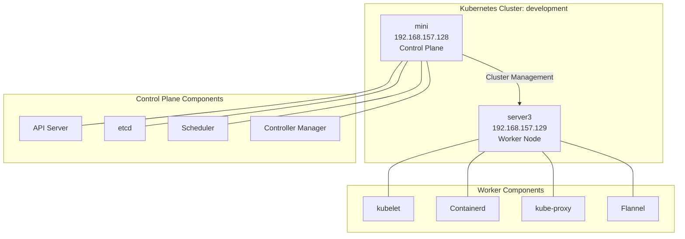

# ☸️ Kubernetes Worker Node Integration

> Joining `server3` to the existing Kubernetes cluster running on `mini` using `kubeadm`.

---

## 📌 Project Overview

In this phase of the Homelab project, a second Ubuntu server was added to the existing Kubernetes cluster as a Worker Node.

The cluster was initially running on a single machine (`mini`). The goal was to expand the cluster by adding `server3` and allowing Kubernetes to schedule workloads across multiple nodes.

Instead of creating a new cluster, `server3` was joined to the existing cluster using `kubeadm join`.

During this process, several issues related to Containerd, Kubernetes networking, CNI initialization, and Linux kernel modules were encountered and resolved.

---

## 🏗️ Architecture

### Before Joining the Worker

The Kubernetes cluster initially consisted of a single node:

| Node | IP Address | Role | Status |
|---|---|---|---|
| mini | 192.168.157.128 | Control Plane | Ready |

### After Joining the Worker

| Node | IP Address | Role | Status |
|---|---|---|---|
| mini | 192.168.157.128 | Control Plane | Ready |
| server3 | 192.168.157.129 | Worker Node | Ready |

### Cluster Architecture



---

## 🖥️ Environment

| Component | mini | server3 |
|---|---|---|
| OS | Ubuntu 22.04.5 LTS | Ubuntu 22.04.5 LTS |
| IP Address | 192.168.157.128 | 192.168.157.129 |
| Kubernetes | v1.37.2 | v1.37.2 |
| Container Runtime | containerd | containerd |
| Containerd Version | 1.7.28 | 1.7.27 |
| Role | Control Plane | Worker |
| CNI | Flannel | Flannel |

### Network Configuration

| Configuration | Value |
|---|---|
| VM Network | 192.168.157.0/24 |
| Gateway | 192.168.157.2 |
| Pod Network | 10.244.0.0/16 |
| CNI | Flannel |
| Flannel Backend | VXLAN |

---

# 🚀 1. Preparing the Worker Node

Before joining `server3` to the cluster, the Kubernetes components and container runtime needed to be configured properly.

The following components were required:

- kubeadm
- kubelet
- kubectl
- containerd
- CNI plugins

The Kubernetes packages were installed using the same version as the Control Plane.

### Verify Kubernetes Versions

```bash
kubeadm version
kubelet --version
kubectl version --client
```

Expected version:

```text
v1.37.2
```

### Verify Containerd

```bash
containerd --version
```

The installed version on `server3` was:

```text
containerd containerd.io 1.7.27
```

### Verify Services

```bash
sudo systemctl is-active containerd kubelet
```

Both services should be active.

---

# 🔧 2. Containerd Configuration

Containerd was configured to use the CRI plugin and SystemdCgroup.

The configuration file:

```text
/etc/containerd/config.toml
```

The following settings were checked:

```toml
version = 2

disabled_plugins = []

[plugins."io.containerd.grpc.v1.cri".containerd]
    default_runtime_name = "runc"

[plugins."io.containerd.grpc.v1.cri".containerd.runtimes.runc]
    runtime_type = "io.containerd.runc.v2"

[plugins."io.containerd.grpc.v1.cri".containerd.runtimes.runc.options]
    SystemdCgroup = true
```

### Why SystemdCgroup?

Kubernetes and Containerd should use compatible cgroup management configurations.

Using SystemdCgroup allows the container runtime to manage cgroups through systemd, which is the recommended configuration for systems using systemd.

### Verify Containerd Configuration

```bash
sudo containerd --config /etc/containerd/config.toml config dump
```

Check the runtime configuration:

```bash
sudo containerd --config /etc/containerd/config.toml config dump | grep -n -A15 'runtimes.runc]'
```

---

# 🔗 3. Joining server3 to the Cluster

The Worker Node was joined to the existing Kubernetes cluster using kubeadm.

### Generate the Join Command

On the Control Plane (`mini`):

```bash
sudo kubeadm token create --print-join-command
```

The command generated by kubeadm contains:

- Control Plane IP address
- Kubernetes API Server port
- Bootstrap token
- Discovery token CA certificate hash

### Execute the Join Command

On `server3`:

```bash
sudo kubeadm join <CONTROL-PLANE-IP>:6443 \
    --token <TOKEN> \
    --discovery-token-ca-cert-hash sha256:<HASH> \
    --cri-socket unix:///run/containerd/containerd.sock
```

Example:

```bash
sudo kubeadm join 192.168.157.128:6443 \
    --token <TOKEN> \
    --discovery-token-ca-cert-hash sha256:<HASH> \
    --cri-socket unix:///run/containerd/containerd.sock
```

> ⚠️ Never publish bootstrap tokens in GitHub repositories. Tokens should be generated when needed and revoked if exposed.

### Successful Join Message

The command successfully completed and returned:

```text
This node has joined the cluster
```

The TLS bootstrap process was also completed successfully.

At this point, `server3` had joined the cluster, but it was not yet Ready.

---

# 🔍 4. Initial Node Status

On the Control Plane:

```bash
kubectl get nodes -o wide
```

Initial output:

```text
NAME      STATUS     ROLES           VERSION
mini      Ready      control-plane   v1.37.2
server3   NotReady   <none>          v1.37.2
```

Although the join operation was successful, the Worker Node was not ready to receive workloads.

### Inspect Node Conditions

```bash
kubectl describe node server3
```

The important condition was:

```text
Ready: False
```

The message indicated:

```text
KubeletNotReady:
container runtime network not ready

NetworkReady=false

NetworkPluginNotReady:
cni plugin not initialized
```

This indicated that the container runtime was running, but the Kubernetes networking plugin had not been initialized successfully.

---

# 🌐 5. Installing and Troubleshooting Flannel

Flannel was already installed on the Control Plane.

The Flannel DaemonSet automatically attempted to create a Flannel Pod on the newly joined Worker Node.

### Check Flannel Pods

```bash
kubectl get pods -n kube-flannel -o wide
```

Initial output:

```text
NAME                    READY   STATUS
kube-flannel-ds-xxxxx    1/1     Running
kube-flannel-ds-yyyyy    0/1     Init:0/2
```

The Flannel Pod on `mini` was running, but the Pod on `server3` was stuck during initialization.

---

## ❌ Problem 1: Pause Image Pull Failure

### Symptoms

The Flannel Pod on `server3` could not create its Pod Sandbox.

Events showed:

```text
FailedCreatePodSandBox

failed to get sandbox image "registry.k8s.io/pause:3.8"

failed to pull image

403 Forbidden
```

Additional errors included:

```text
dial tcp <IP>:443: connect: connection refused
```

And:

```text
lookup registry.k8s.io on 127.0.0.53:53:
server misbehaving
```

### Cause

Containerd needed the Kubernetes pause image to create Pod Sandboxes.

However, `server3` was unable to access the container registry reliably because of network connectivity restrictions.

### Network Connectivity Test

On `server3`:

```bash
curl -I https://registry.k8s.io/v2/
```

After enabling the VPN, the registry became reachable.

The response:

```text
HTTP/2 401
```

was normal for an unauthenticated request to the registry API.

It confirmed that the registry endpoint was reachable.

### Pull the Pause Image Manually

```bash
sudo ctr -n k8s.io images pull registry.k8s.io/pause:3.8
```

The image was successfully downloaded and unpacked.

### Verify the Image

```bash
sudo ctr -n k8s.io images ls
```

The pause image was available:

```text
registry.k8s.io/pause:3.8
```

### Verify Containerd Sandbox Image

```bash
sudo containerd --config /etc/containerd/config.toml config dump | grep sandbox_image
```

Output:

```text
sandbox_image = "registry.k8s.io/pause:3.8"
```

The configured sandbox image and the downloaded image matched.

---

# ❌ Problem 2: Containerd Runtime Configuration Error

After the pause image was available, another error appeared.

### Error

```text
container.Runtime.Name must be set:
invalid argument
```

This error appeared in the events when Kubernetes attempted to create the Pod Sandbox.

It affected both:

- kube-proxy
- Flannel

### Investigation

Containerd runtime configuration was inspected:

```bash
sudo containerd --config /etc/containerd/config.toml config dump
```

The runtime configuration showed:

```toml
default_runtime_name = "runc"
```

However, the runtime definition was incomplete.

The `runtime_type` was empty:

```toml
[plugins."io.containerd.grpc.v1.cri".containerd.runtimes.runc]

runtime_type = ""
```

### Cause

Containerd knew that the default runtime was named `runc`, but its runtime definition did not specify the runtime implementation.

Therefore, the CRI plugin could not create containers using the configured runtime.

### Backup the Configuration

Before editing:

```bash
sudo cp /etc/containerd/config.toml \
    /etc/containerd/config.toml.backup-runtime
```

### Fix the Runtime Configuration

The configuration was edited:

```bash
sudo nano /etc/containerd/config.toml
```

The incorrect value:

```toml
runtime_type = ""
```

was changed to:

```toml
runtime_type = "io.containerd.runc.v2"
```

The complete runtime configuration became:

```toml
[plugins."io.containerd.grpc.v1.cri".containerd.runtimes.runc]
    runtime_type = "io.containerd.runc.v2"

[plugins."io.containerd.grpc.v1.cri".containerd.runtimes.runc.options]
    SystemdCgroup = true
```

### Verify the Configuration

```bash
sudo containerd --config /etc/containerd/config.toml config dump | grep -n -A15 'runtimes.runc]'
```

### Restart Containerd

```bash
sudo systemctl restart containerd
```

Verify:

```bash
sudo systemctl is-active containerd kubelet
```

Both services were active after the restart.

Docker containers were also checked to ensure that the existing Docker services were not disrupted.

---

# ❌ Problem 3: Missing br_netfilter Kernel Module

After resolving the Containerd runtime issue, the Flannel Pod was able to start its Init Containers.

However, the main Flannel container continued restarting.

### Inspect the Pod

```bash
kubectl describe pod <FLANNEL-POD-NAME> -n kube-flannel
```

### Inspect Logs

```bash
kubectl logs <FLANNEL-POD-NAME> \
    -n kube-flannel \
    --all-containers=true
```

### Error

```text
Failed to check br_netfilter:

stat /proc/sys/net/bridge/bridge-nf-call-iptables:
no such file or directory
```

### Cause

The Linux kernel module `br_netfilter` was not loaded on `server3`.

Flannel needed the bridge networking kernel functionality to configure the Kubernetes networking environment.

The missing module meant the required kernel networking settings were unavailable.

---

## 🔧 Solution: Load br_netfilter

On `server3`:

```bash
sudo modprobe br_netfilter
```

### Verify the Module

```bash
lsmod | grep br_netfilter
```

Expected output:

```text
br_netfilter
```

### Verify the Kernel Settings

```bash
ls /proc/sys/net/bridge/
```

The following settings should now exist:

```text
bridge-nf-call-iptables
bridge-nf-call-ip6tables
bridge-nf-call-arptables
```

---

# ⚙️ 6. Configure Kubernetes Networking on server3

The following kernel parameters were configured.

### Enable Bridge Traffic Processing

```bash
sudo sysctl -w net.bridge.bridge-nf-call-iptables=1
```

```bash
sudo sysctl -w net.bridge.bridge-nf-call-ip6tables=1
```

### Enable IP Forwarding

```bash
sudo sysctl -w net.ipv4.ip_forward=1
```

### Verify

```bash
sysctl net.bridge.bridge-nf-call-iptables
sysctl net.bridge.bridge-nf-call-ip6tables
sysctl net.ipv4.ip_forward
```

Expected values:

```text
net.bridge.bridge-nf-call-iptables = 1
net.bridge.bridge-nf-call-ip6tables = 1
net.ipv4.ip_forward = 1
```

---

# 💾 7. Make Kernel Settings Persistent

The kernel modules and sysctl settings were configured to load automatically after reboot.

### Configure Modules

```bash
sudo nano /etc/modules-load.d/k8s.conf
```

Contents:

```text
br_netfilter
overlay
```

### Configure Sysctl Parameters

```bash
sudo nano /etc/sysctl.d/99-kubernetes.conf
```

Contents:

```text
net.bridge.bridge-nf-call-iptables = 1
net.bridge.bridge-nf-call-ip6tables = 1
net.ipv4.ip_forward = 1
```

### Apply the Settings

```bash
sudo sysctl --system
```

---

# 🔄 8. Recreate the Flannel Pod

After correcting the kernel configuration, the existing Flannel Pod was deleted so that the DaemonSet could recreate it.

On the Control Plane:

```bash
kubectl delete pod <FLANNEL-POD-NAME> -n kube-flannel
```

The DaemonSet automatically created a replacement Pod on `server3`.

### Why Delete the Pod?

Deleting the Pod did not uninstall Flannel.

The DaemonSet controller continuously maintains the desired number of Pods.

When a Pod is deleted, Kubernetes automatically creates a replacement.

This allowed Flannel to restart using the corrected host configuration.

---

# ⚠️ 9. kubectl Configuration Issue When Using Root

During troubleshooting, commands were accidentally executed as root on `mini`.

The following errors appeared:

```text
Couldn't get current server API group list

Get "http://localhost:8080/api":

connect: connection refused
```

### Cause

The Kubernetes configuration file was available to the `mini` user, but root did not have its own kubeconfig file.

The default kubectl configuration path is:

```text
~/.kube/config
```

For root, this becomes:

```text
/root/.kube/config
```

The configuration was available at:

```text
/home/mini/.kube/config
```

### Solution

Return to the normal user:

```bash
exit
```

Then execute kubectl commands using the `mini` user.

Alternatively, temporarily specify the kubeconfig:

```bash
export KUBECONFIG=/home/mini/.kube/config
```

---

# ⚠️ 10. Additional Warning During kubeadm Join

During the Worker Node join process, the following warning appeared:

```text
RuntimeConfig from runtime service failed

unknown method RuntimeConfig
for service runtime.v1.RuntimeService
```

### Explanation

The installed Containerd version was `1.7.27`.

The Kubernetes version was `1.37.2`.

The CRI RuntimeConfig method was not supported by this Containerd version.

Kubelet used the configured cgroup driver as a fallback.

The join operation still completed successfully.

This warning did not prevent `server3` from joining the cluster or becoming Ready.

However, Containerd compatibility should be reviewed in a future maintenance phase.

---

# 🧪 11. Final Verification

After resolving the Containerd runtime configuration and loading the required kernel modules, the Flannel Pod on `server3` became Running.

### Verify Nodes

```bash
kubectl get nodes -o wide
```

Final expected result:

```text
NAME      STATUS   ROLES           VERSION
mini      Ready    control-plane   v1.37.2
server3   Ready    <none>          v1.37.2
```

### Verify Flannel

```bash
kubectl get pods -n kube-flannel -o wide
```

Successful output:

```text
NAME                    READY   STATUS    NODE
kube-flannel-ds-xxxxx    1/1     Running   mini
kube-flannel-ds-yyyyy    1/1     Running   server3
```

Both Flannel Pods were successfully running.

### Verify System Pods

```bash
kubectl get pods -n kube-system -o wide
```

The Kubernetes system components were checked to ensure that they were running successfully.

---

# 📊 Troubleshooting Summary

| Problem | Cause | Solution |
|---|---|---|
| Worker Node NotReady | CNI not initialized | Troubleshoot Flannel |
| Pause image pull failure | Registry connectivity issues | Enable network connectivity and pull image |
| `container.Runtime.Name must be set` | Missing runtime_type | Configure `io.containerd.runc.v2` |
| Flannel CrashLoopBackOff | Missing `br_netfilter` | Load kernel module |
| Missing `/proc/sys/net/bridge` | Kernel module not loaded | `modprobe br_netfilter` |
| kubectl connects to localhost:8080 | Root kubeconfig missing | Use mini user or specify KUBECONFIG |
| RuntimeConfig warning | Containerd CRI compatibility | Kubelet fallback; review runtime version |

---

# 🧠 What I Learned

- A successful `kubeadm join` does not necessarily mean a Worker Node is Ready.
- Kubernetes Nodes depend on a functioning container runtime and CNI plugin.
- Containerd must have a valid runtime configuration to create Pod Sandboxes.
- The pause image is required for Kubernetes Pod Sandbox creation.
- Flannel requires proper Linux kernel networking modules and settings.
- `br_netfilter` is important for bridge networking and iptables integration.
- DaemonSets automatically recreate deleted Pods.
- `kubectl` depends on kubeconfig to communicate with the Kubernetes API Server.
- Troubleshooting should be based on logs, events, and Node conditions rather than repeatedly deleting Pods.
- Network connectivity to container registries is important when deploying Kubernetes components.
- A Worker Node is part of the same cluster as the Control Plane, not an independent Kubernetes cluster.

---

# ✅ Final Status

The Worker Node was successfully integrated into the existing Kubernetes cluster.

```text
Cluster: development

Control Plane:
mini
192.168.157.128
Ready

Worker Node:
server3
192.168.157.129
Ready

CNI:
Flannel

Pod Network:
10.244.0.0/16
```

Both Nodes are Ready, and Flannel is running on both machines.

The cluster is now ready for the next phase: deploying application workloads and DevOps services.

---

## 🔜 Next Steps

- [ ] Test Pod-to-Pod communication
- [ ] Test DNS resolution inside the cluster
- [ ] Deploy a test application
- [ ] Configure the local Docker Registry for Kubernetes
- [ ] Deploy VProfile
- [ ] Configure application Services
- [ ] Explore Kubernetes scheduling across Nodes
- [ ] Deploy monitoring tools
